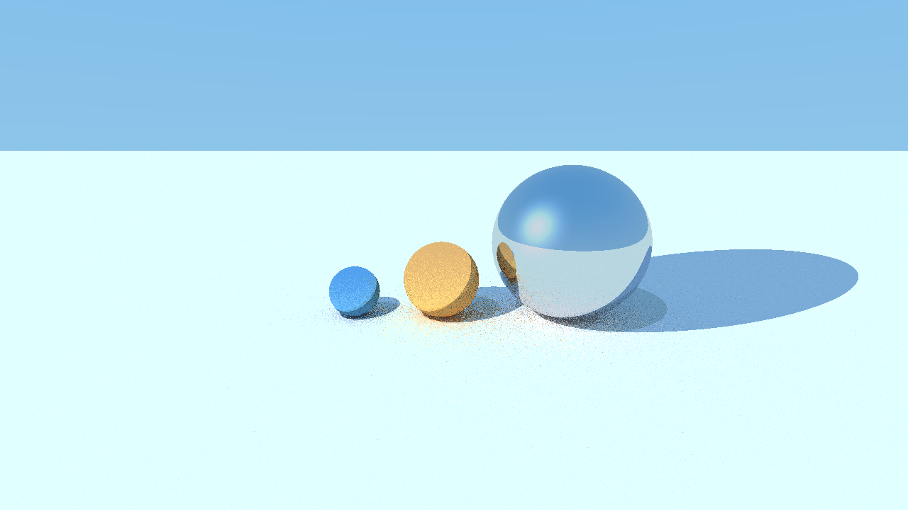
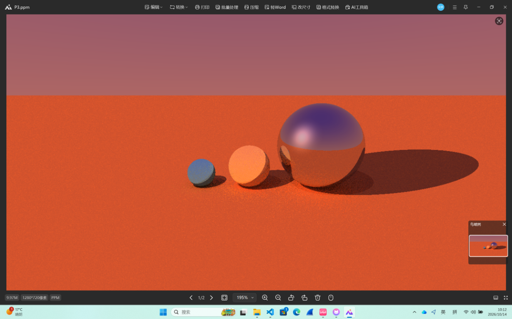

# Ray Tracer from Scratch

A simple ray tracer implemented from scratch in C++17. The current scene features diffuse and reflective spheres, a diffuse ground plane, point and directional lights, and a gradient sky.

## Rendered Images

### Daylight Scene



### Sunset Scene



## Build

Requires CMake 3.16 or later and a C++17-compatible compiler.

```sh
cmake -S . -B build
cmake --build build
```

## Run

Run the program from the repository root. The rendered image will be written to `images/P3.ppm`:

```sh
./build/ray_tracer
```

The output is a 1280 × 720 PPM image. Open it with an image viewer that supports PPM. `images/render.png` is a PNG preview of the render.

## Project Structure

- `main.cpp`: Scene setup, camera, lighting, and per-pixel rendering
- `data_structure/`: Vectors, colors, rays, and camera
- `objects/`: Base scene object, spheres, and walls
- `material/`: Diffuse and mirror materials
- `light_source/`: Point, directional, and ambient lights
- `images/`: Render output and previews
